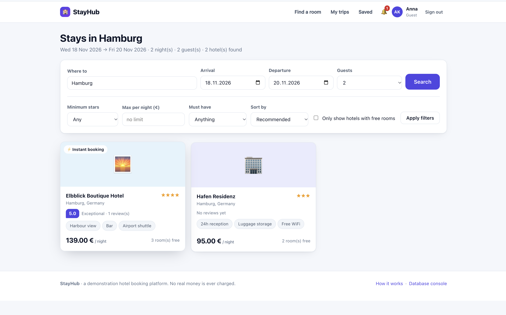
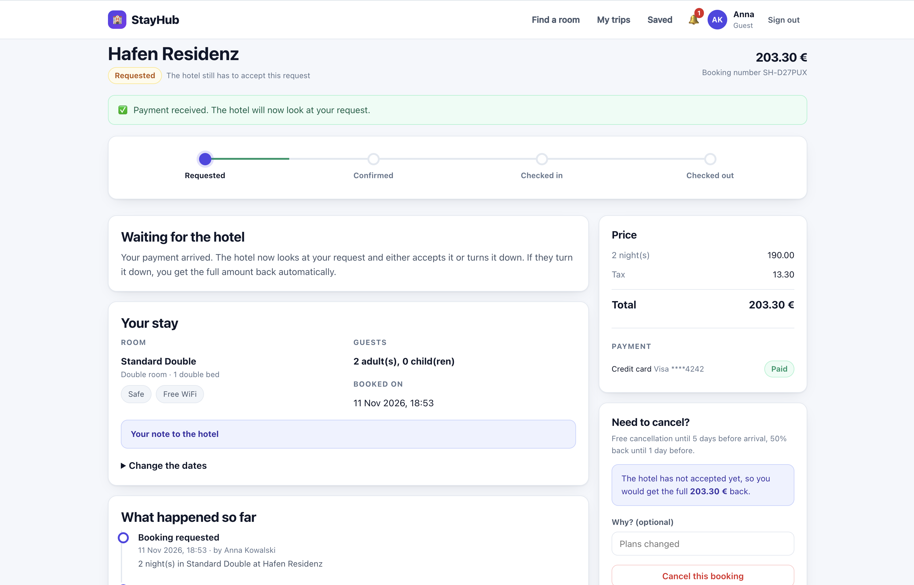
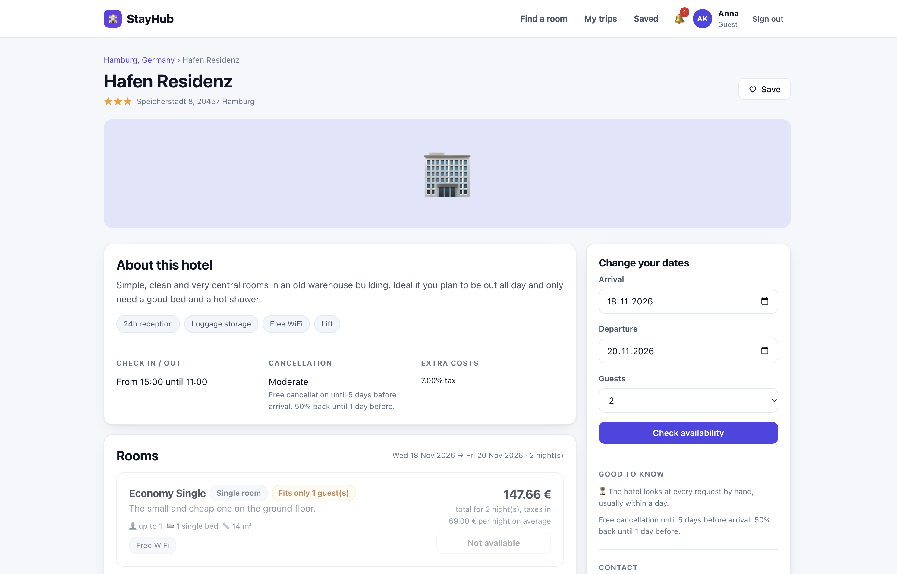
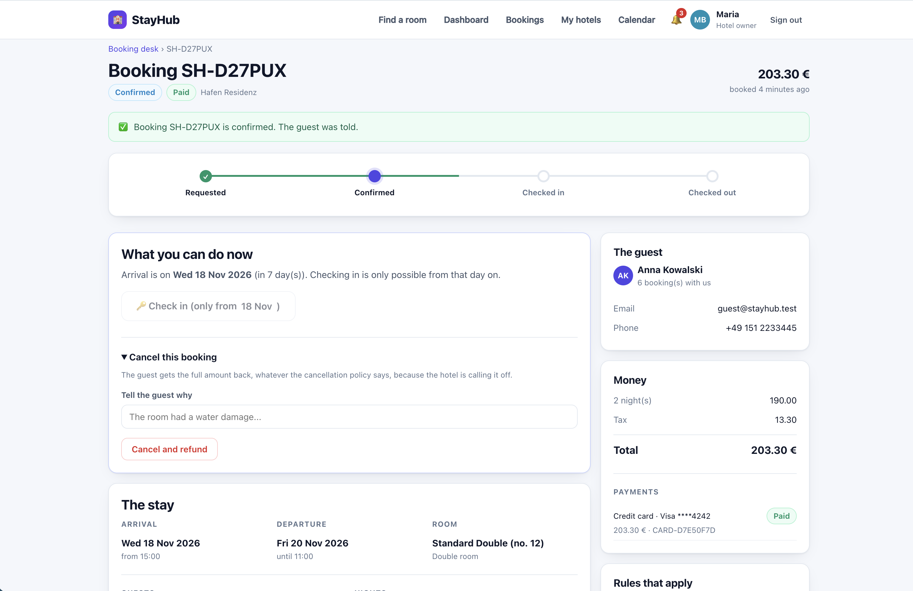
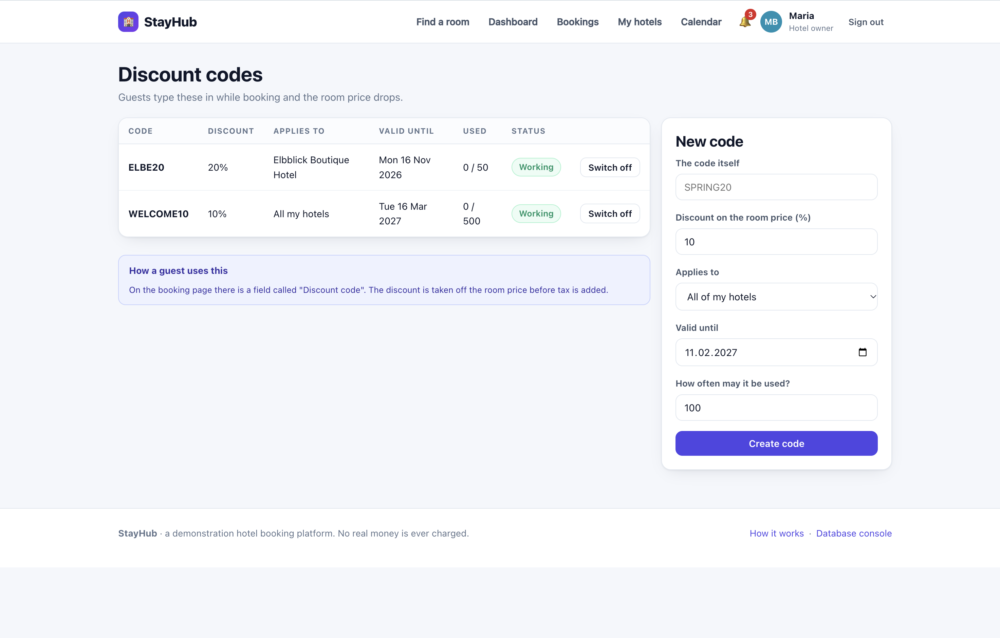
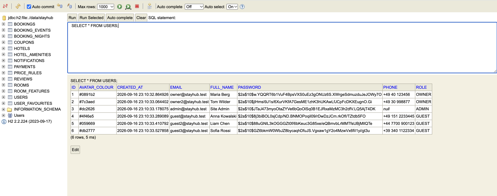

# Reference App — Requirements (Lab 1)

> AI-assisted (Claude): drafted the comparison against our requirements and located the evidence in the reference app's source code (10.11), and wrote the picture captions (11.11).
>
> Done by Urbee: ran the app, took all six screenshots, and checked each claim and caption against our requirements and the running app.

We ran StayHub, the reference app, on our computer (`./mvnw spring-boot:run`, demo logins `guest@stayhub.test` and `owner@stayhub.test`) and compared it with our requirements in [requirements.md](../requirements/requirements.md). As evidence we give screenshots and the file or class in the reference app's source code; paths are relative to `src/main/java/com/stayhub/`.

## 1. Covered

| Our requirement | What the app does | Evidence |
|---|---|---|
| FR-01 Search by city and dates | Search page with destination, arrival and departure. Partly: inside a hotel only free rooms are offered, but fully booked hotels still appear in the result unless the guest ticks "only available" | `web/SearchController.java` (`search(...)`, `onlyAvailable` defaults to `false`), `service/AvailabilityService.java` (`freeRooms`) |
| FR-03 Book a room / reject impossible dates | Rejects arrival in the past and departure before arrival | `service/BookingService.java` (`validateDates`: "The departure date has to be after the arrival date.") |
| FR-07 No double booking | Before a booking request is saved, the app checks that the room is free | `service/BookingService.java` (`request`: "Sorry, this room has just been taken…"), `service/AvailabilityService.java` (`isFree`) |
| FR-08 Fixed room number | Every booking is for one concrete room, and each room has a room number | `domain/Room.java` (field `roomNumber`) |
| FR-10 Guest data | Partly: registration requires name and email, and the phone number is optional — but the name is one field ("full name"), not first and last name | `web/AuthController.java` (`RegistrationForm`: `fullName`, `email` required, `phone` optional), `domain/User.java` |
| FR-18 Owner cancels → full refund | When the hotel cancels, 100 % is refunded | `service/BookingService.java` (`cancel`: "Cancelled by the hotel, so the full amount goes back.") |
| FR-20 Several hotels per owner | One owner account manages a list of hotels | `web/OwnerController.java` (`/owner/hotels`) |
| FR-22 / FR-23 Reply to reviews, no deleting | Owners can reply to reviews; there is no delete function for reviews | `web/OwnerController.java` (`/reviews/{id}/reply`, no delete mapping for reviews) |

*Search for Hamburg: hotels are listed even when they have no free room, unless "only available" is ticked.*

## 2. Ignored

The five gaps with the biggest consequences:

1. **FR-06 Instant confirmation (D-06).** By default a booking stays "Requested" until the owner accepts it. Instant booking is only a per-hotel option and is switched off by default. Consequence: guests wait and book elsewhere — exactly what Selin warned about.
   Evidence: `domain/Hotel.java` (`instantBooking = false`), `domain/BookingStatus.java` (`REQUESTED`: "The hotel still has to accept this request").

   
2. **FR-11 / FR-12 Cancellation rule (D-01, D-02).** Instead of free cancellation up to 48 h before arrival, each hotel picks one of three policies (Flexible, Moderate, Strict; default Moderate). Guests are treated differently depending on the hotel, and the rule Jan decided is not available.
   Evidence: `domain/CancellationPolicy.java`, `domain/Hotel.java` (`cancellationPolicy = MODERATE`).

   
3. **FR-17 Owner cancellation limit (D-04).** An owner can cancel a confirmed booking at any time, even on the day of arrival. A guest can lose the room at the last minute — Selin's "worst call".
   Evidence: `domain/Booking.java` (`isCancellable()` checks only the status, no date), `service/BookingService.java` (`cancel`).

   
4. **NFR-06 / NFR-07 Data retention (D-16, D-17).** There is no function that deletes guest data or invoices after 2 or 3 years; everything is kept forever. This breaks Jan's decision and likely data-protection law.
   Evidence: no deletion or retention logic for users, bookings or payments anywhere in the code (only hotels, rooms and rates can be deleted, `web/OwnerController.java`).
5. **NFR-09 Accessibility.** The page templates contain no `alt` texts and no ARIA attributes, so screen-reader users get little help. There is also no way to find wheelchair-accessible rooms (FR-02).
   Evidence: `src/main/resources/templates/` (0 `alt=` / `aria-` attributes), `web/SearchController.java` (no accessibility filter).

Also ignored: changing a confirmed booking with price difference (FR-13/14 — dates can only be changed while still "Requested", `domain/Booking.java` `isEditable()`), extending a stay (FR-15), no-show handling (FR-16), and removing spam or racist reviews by support (FR-24 — the admin page only shows numbers, `web/AdminController.java`).

## 3. Invented

Features no stakeholder asked for:

| Feature | Evidence | A problem? |
|---|---|---|
| Discount coupons | `domain/Coupon.java`, `web/OwnerController.java` (`/coupons`) | Yes: changes prices in a way nobody decided; may conflict with "the price is the price" (Selin) |
| Three cancellation policies per hotel | `domain/CancellationPolicy.java` | Yes: replaces the rule Jan decided (D-01) |
| Weekend surcharge and cleaning fee per hotel | `domain/Hotel.java` (`weekendSurchargePercent`, `cleaningFee`) | Possibly: extra price parts must be shown in the total (FR-04) |
| Maximum stay of 60 nights | `service/BookingService.java` (`validateDates`) | Possibly: a business rule nobody asked for |
| Favourites, notifications, star ratings, owner calendar, admin dashboard | `domain/User.java` (`favourites`), `domain/Notification.java`, `web/AdminController.java` | Not harmful, but extra scope to build, test and maintain |
| Open database console without password | `application.properties` (`spring.h2.console.enabled=true`, password empty), `config/SecurityConfig.java` (`/h2-console/**` permitted) | Yes: anyone who reaches the server can read all guest data |

*Coupons: a pricing feature nobody asked for.*

*The database console opens with user `sa` and no password. A simple query shows every user's full name, email address and phone number (passwords are stored only as hashes). It also shows that the name is stored as one field (`FULL_NAME`), not as first and last name (FR-10).*

## 4. Silently decided

The app was generated from one prompt that said: *"take all the technical decisions yourself"*. Nobody at Kojenwerk was asked about any of these conflicts.

| Conflict | Malte | Selin | What the app decided | Jan's decision | Evidence |
|---|---|---|---|---|---|
| Overbooking | Allow ~10 % | Never | No overbooking (Selin) | No overbooking (D-07) | `service/AvailabilityService.java` (`isFree`) |
| Confirmation | Owner accepts each request | Instant | Owner accepts, unless the hotel switches on instant booking (Malte) | Instant (D-06) | `domain/Hotel.java` (`instantBooking = false`) |
| Cancellation | Full price if < 14 days | Free until the day before | Each owner chooses one of three policies (neither) | Free until 48 h before (D-01) | `domain/CancellationPolicy.java` |
| Payment | Pay when booking | Allow paying at the hotel | Online only, credit card or PayPal (Malte) | Online only (D-03) | `domain/PaymentMethod.java` |
| Guest data | Full data incl. ID copy | Name and email | Full name, email, optional phone (Selin) | First and last name, email, optional phone (D-08) | `domain/User.java` |
| Owner cancels | Must be possible | Must never happen | Owner can cancel any time (Malte) | Up to 14 days before arrival (D-04) | `domain/Booking.java` (`isCancellable`) |

The app happens to match Jan's decisions on overbooking, payment and guest data, but only by chance. On confirmation, cancellation and owner cancellation it decided the opposite of what Jan wants — and nobody was asked.
