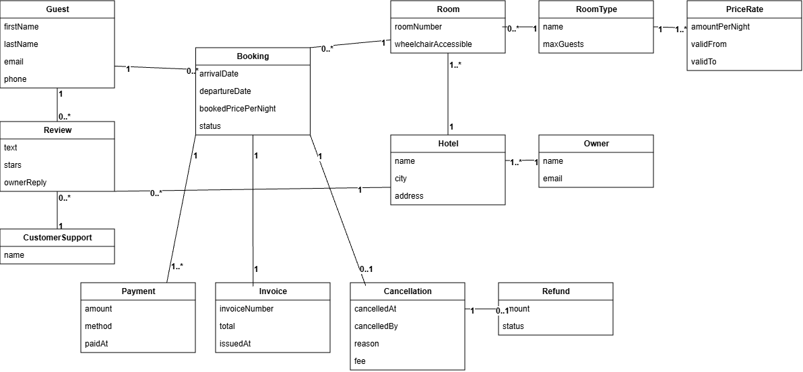

# Domain Model

<!--
Concepts of the hotel booking DOMAIN — not software.
No controllers, services, repositories, database tables or screens.
Save the diagram as docs/design/domain-model.png.
-->

## Concepts and responsibilities

| Concept | Knows | Does | Traces to |
|---|---|---|---|
| | | | UC-__ / FR-__ |

## Associations

| From | To | Multiplicity | Meaning |
|---|---|---|---|
| | | | |

## Attributes

| Concept | Attributes |
|---|---|
| | |

## Invariants

<!-- Rules that must always hold, and which concept is responsible for each. -->

| Rule | Responsible concept |
|---|---|
| | |
