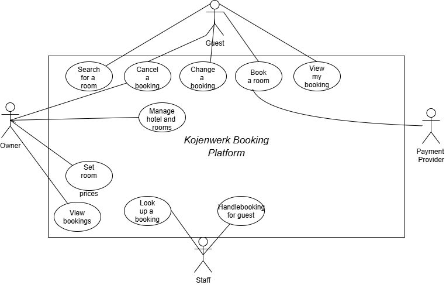

# Use Cases

> AI-assisted (Claude): Claude coached by asking questions and offering multiple-choice options; it formatted my chosen answers into the template. Actors, use cases, flows and choices decided by Krish.

## UC-01 — Book a room

| Field | |
|---|---|
| Related requirements | *(filled in the Lab 1 report)* |
| Initiating actor | Guest |
| Actor's goal | Secure a room in a hotel for the chosen dates |
| Participating actors | Payment Provider; Owner (if bookings need owner approval, see Q4) |
| Preconditions | The hotel and its rooms are offered on the platform. The guest has found a room (UC Search for a room). |
| Postconditions | A booking for the guest exists for the chosen room and dates. The room is no longer available to others for these dates. Payment handled as decided (see Q2). |

**Main success scenario**

1. → Guest selects a suitable room and the stay dates (arrival and departure).
2. ← System shows the room details (Wi-Fi, parking, …) and the total price including all taxes and fees.
3. → Guest enters his details (which data: see Q6).
4. → Guest chooses to pay and enters payment data.
5. ← System sends the payment to the Payment Provider, which confirms it.
6. ← System reserves the room for these dates (booking status: see Q4).
7. ← System shows a confirmation and sends a receipt to the guest.

**Alternate flow A — Payment fails** (branches at step 5)

- 5a. ← Payment Provider declines the payment; system informs the guest. No booking is made.
- 5b. → Guest chooses another payment method; continue at step 4.

**Alternate flow B — Room no longer available** (branches at step 4)

- 4a. ← Before payment, system finds the room was booked by someone else meanwhile and informs the guest. Nothing is charged.
- 4b. → Guest selects another room; continue at step 1.

**Alternate flow C — Dates in the past** (branches at step 1)

- 1a. ← System rejects the arrival date because it is in the past and asks for valid dates.
- 1b. → Guest enters new dates; continue at step 1.

## UC-02 — Cancel a booking

| Field | |
|---|---|
| Related requirements | *(filled in the Lab 1 report)* |
| Initiating actor | Guest |
| Actor's goal | Call off the booking and get back as much money as the rules allow |
| Participating actors | Payment Provider, Owner |
| Preconditions | The guest has a confirmed booking whose stay has not yet started. |
| Postconditions | The booking is cancelled. The room is available for other guests again for these dates. Money is refunded according to the cancellation rule (see Q1). |

**Main success scenario**

1. → Guest opens his booking and chooses to cancel it.
2. ← System shows the refund amount according to the cancellation rule (see Q1).
3. → Guest confirms the cancellation.
4. ← System sets the booking to cancelled and makes the room available again for these dates.
5. ← System asks the Payment Provider to refund the amount.
6. ← System informs the Owner about the cancellation.
7. ← System sends the guest a cancellation confirmation.

**Alternate flow A — Late cancellation** (branches at step 2)

- 2a. ← System shows that the cancellation is late and the refund is reduced or zero according to the cancellation rule (see Q1).
- 2b. → Guest confirms anyway (continue at step 3) or aborts; the booking stays confirmed.

**Alternate flow B — Refund fails** (branches at step 5)

- 5a. ← Payment Provider reports an error.
- 5b. ← System keeps the booking cancelled and flags the refund for Kojenwerk Staff to handle.

**Alternate flow C — Owner cancels the booking** (initiated by Owner, see Q3)

- C1. → Owner chooses to cancel a guest's booking.
- C2. ← System sets the booking to cancelled, informs the guest and refunds the full amount.

## UC-03 — Accept or decline a booking request

| Field | |
|---|---|
| Related requirements | *(filled in the Lab 1 report)* |
| Initiating actor | Owner |
| Actor's goal | Decide who stays in their hotel |
| Participating actors | Guest (gets informed), Payment Provider (refund if declined) |
| Preconditions | A guest has sent a booking request that is still open (only if bookings need owner approval, see Q4). |
| Postconditions | The request is accepted (booking confirmed) or declined (guest informed, any payment refunded). |

**Main success scenario**

1. ← System notifies the owner about a new booking request.
2. → Owner opens the request and sees the guest, room and dates.
3. → Owner accepts the request.
4. ← System confirms the booking and informs the guest.

**Alternate flow A — Owner declines** (branches at step 3)

- 3a. → Owner declines the request.
- 3b. ← System informs the guest and asks the Payment Provider to refund the payment.

**Alternate flow B — Owner does not respond** (branches at step 2)

- 2a. Owner does not open or answer the request.
- 2b. ← The request stays open and the guest keeps waiting for a decision (response deadline: see Q4).
